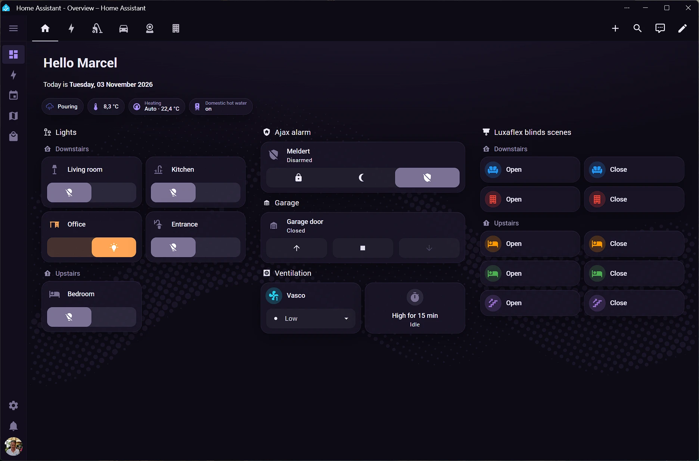
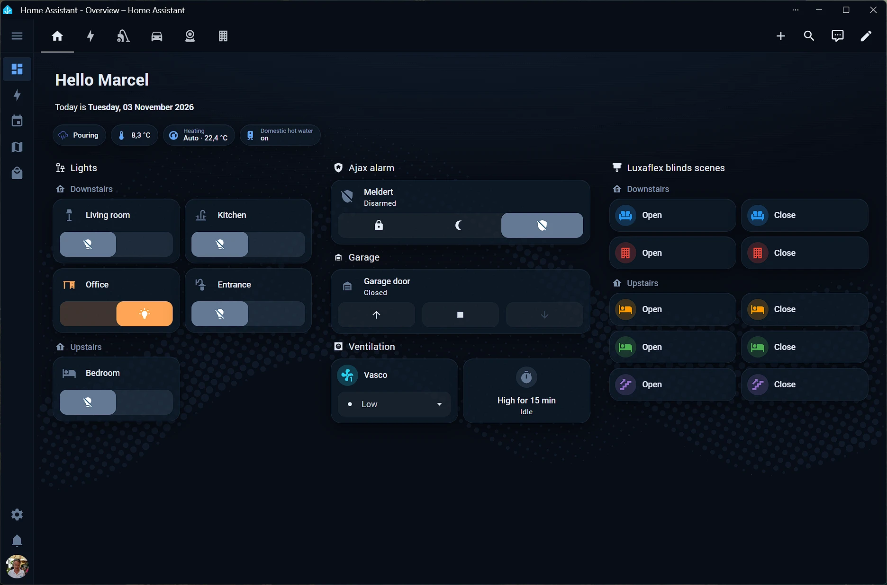
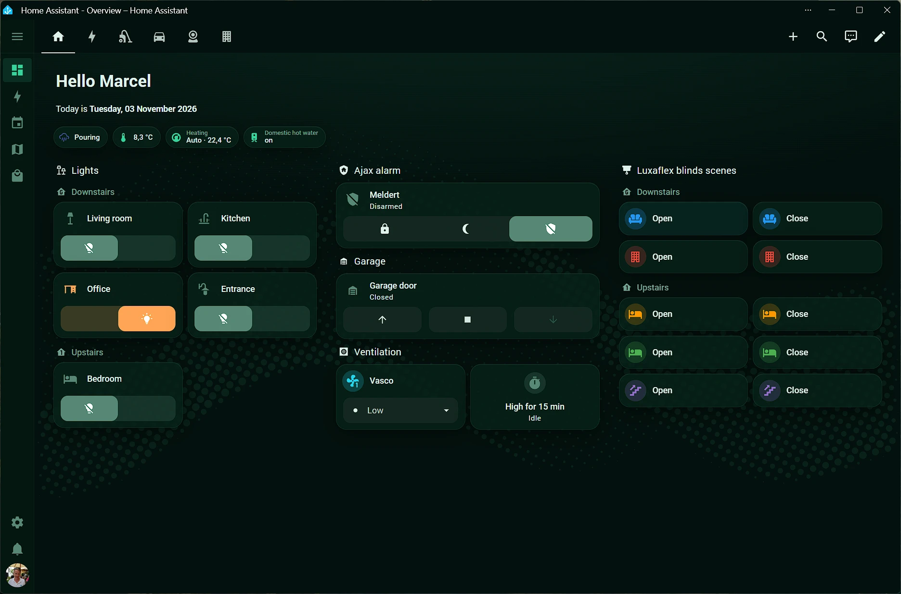
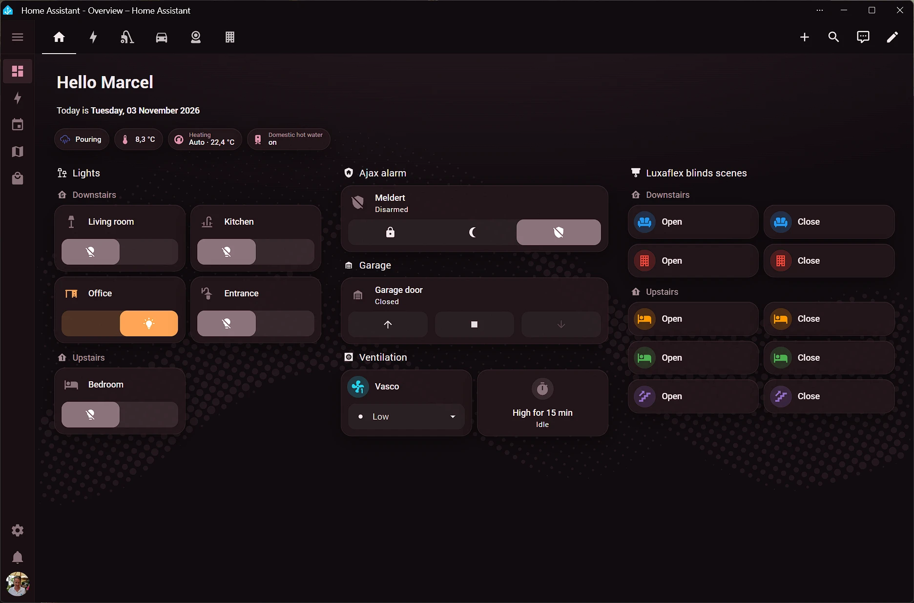
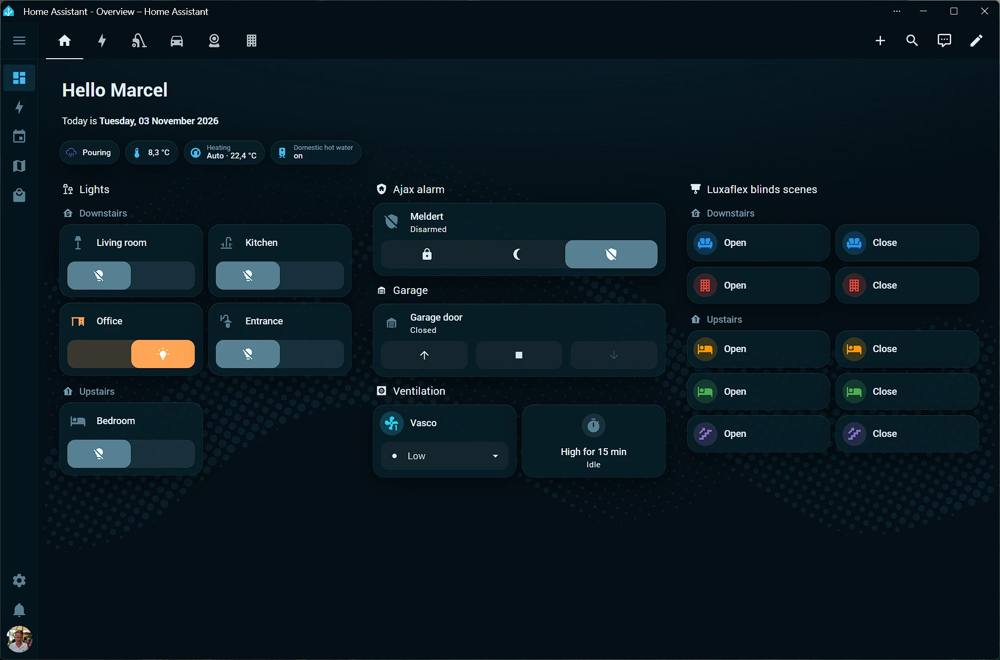

# Wave themes

Themes for [Home Assistant](https://www.home-assistant.io/), each with a light and a dark mode:

| Theme | Light accent | Dark accent |
| --- | --- | --- |
| **Purple wave** | `#7c5cf6` | `#a78bfa` |
| **Sapphire wave** | `#1d4ed8` | `#60a5fa` |
| **Emerald wave** | `#047857` | `#34d399` |
| **Bordeaux wave** | `#7f1d3f` | `#e092ac` |
| **Ocean wave** | `#0369a1` | `#38bdf8` |

The palettes match the Wave style of [Anchor](https://github.com/marcelhoffs/anchor).

[](https://github.com/hacs/integration)

## Screenshots

### Purple wave



### Sapphire wave



### Emerald wave



### Bordeaux wave



### Ocean wave



## Installation

### HACS (recommended)

Wave themes is available in the default HACS store.

[](https://my.home-assistant.io/redirect/hacs_repository/?owner=marcelhoffs&repository=ha-wave&category=theme)

1. Open HACS in Home Assistant (or use the button above).
2. Search for **Wave themes** and download it.
3. Make sure themes are enabled in `configuration.yaml`:

   ```yaml
   frontend:
     themes: !include_dir_merge_named themes
   ```

4. Restart Home Assistant (or run the `frontend.reload_themes` action).
5. Go to your **Profile** and select one of the Wave themes. Set the mode to *Auto* to follow your device’s light/dark setting.

### HACS custom repository

If Wave themes doesn't show up in your HACS store, add it as a custom repository:

1. Open HACS in Home Assistant.
2. Open the menu (⋮) → **Custom repositories**.
3. Add `https://github.com/marcelhoffs/ha-wave` with category **Theme**.
4. Search for **Wave themes** and download it, then follow steps 3–5 above.

If you previously added Wave themes as a custom repository, you can remove that entry: HACS now picks it up from the default store.

HACS installs the themes in `config/themes/wave_themes/`. If you installed version 1.0.0, delete the old `config/themes/sapphire_wave/` folder.

### Manual

Copy `themes/wave_themes.yaml` into the `themes` folder of your Home Assistant configuration directory, then follow steps 3–5 of the HACS installation above.

## Regenerating the themes

`src/purple_wave.yaml` is the hand-tuned source. The other themes are generated from it with Anchor's accent colours, and all five are written to `themes/wave_themes.yaml`:

```sh
python tools/generate.py
```

Edit only `src/purple_wave.yaml` (colours) and `src/wave.svg` (the halftone wave) by hand. The generator adds the wave background and Home Assistant's derived colours (accent and grey scales, buttons, form fields, text, surfaces, scrollbars) to every theme. To add a theme, add an entry to `THEMES` in `tools/generate.py` and run it.

## License

[MIT](LICENSE)
